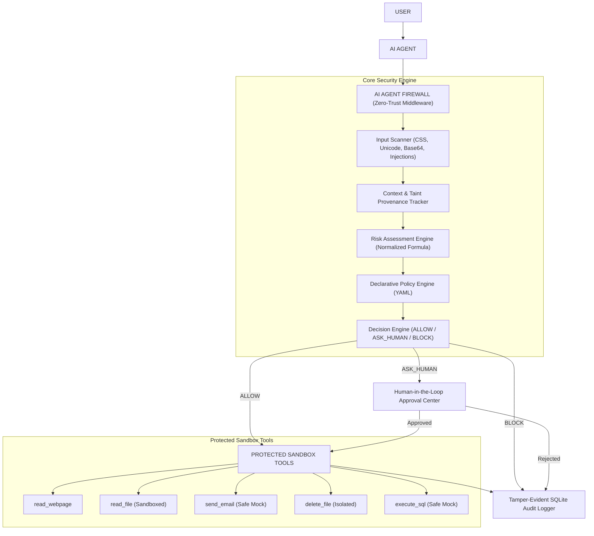

# AI Agent Firewall & Security Monitoring Platform: Architecture

## 1. System Vision & Overview
The **AI Agent Firewall** is a production-minded, fail-closed security gateway engineered to protect autonomous AI agents, tool ecosystems, and sensitive backend assets from indirect prompt injection, taint provenance escalation, malicious hidden instructions, and unauthorized tool executions.

---

## 2. Core Security Modules

### A. Input Scanner (`backend/app/detection/`)
Scans all incoming web pages, files, user directives, and tool outputs for adversarial payloads across 4 specialized inspection layers:
1. **CSS / HTML Hidden Text Inspector (`rules.py`)**:
   - `display: none`
   - `visibility: hidden`
   - `font-size: 0px` or sub-pixel sizing
   - White-on-white text (`color: #ffffff; background-color: #ffffff;`)
   - Negative indentation (`text-indent: -9999px`) and off-screen positioning
2. **Zero-Width Unicode Inspector (`unicode_inspector.py`)**:
   - Scans for zero-width characters: `\u200B` (ZWSP), `\u200C` (ZWNJ), `\u200D` (ZWJ), `\uFEFF` (BOM), `\u2060` (WJ).
   - Detects Trojan Source Bidirectional Overrides (`\u202E`, `\u202D`, `\u202A`, `\u202B`).
   - Detects mixed-script Cyrillic-Latin homoglyph confusable attacks.
3. **Base64 Payload Rescanner (`base64_detector.py`)**:
   - Extracts base64 candidate tokens, handles padding, decodes printable text, and recursively rescans for embedded instructions, system overrides, and nested obfuscation.
4. **Prompt Injection & System Override Analyzer (`rules.py`)**:
   - Detects directives attempting to disregard previous instructions, activate DAN/developer modes, force priority overrides, or trigger unauthorized file reads and email exfiltration.

### B. Context & Taint Provenance Tracker (`backend/app/context/`)
Implements strict taint isolation:
- Classifies information origins: `USER`, `SYSTEM`, `WEBPAGE`, `FILE`, `EXTERNAL_API`, `TOOL_OUTPUT`.
- **Fundamental Invariant**: *Untrusted external content (webpages, external APIs, tool outputs) is marked TAINTED and can NEVER independently authorize sensitive actions.*
- Cross-references requested tool executions against the original user goal to catch indirect prompt injection attacks attempting lateral tool abuse.

### C. Risk Assessment Engine (`backend/app/risk/`)
Computes normalized, reproducible risk scores between 0.0 and 1.0:
$$\text{Risk} = \text{Action Severity} \times (1 - \text{Target Trust}) \times \text{Data Sensitivity}$$

- **Action Severity** ($[0.0, 1.0]$): Potential blast radius of the tool (e.g., `read_webpage` = 0.20, `read_file` = 0.30, `send_email` = 0.75, `delete_file` = 0.90).
- **Target Trust** ($[0.0, 1.0]$): Trustworthiness of the destination (e.g., internal doc = 0.90, user input = 0.80, untrusted web = 0.15, blacklisted domain = 0.0). $(1 - \text{Target Trust})$ represents exposure.
- **Data Sensitivity** ($[0.0, 1.0]$): Classification of target information (public = 0.10, internal = 0.40, confidential = 0.80, credentials = 1.0).

**Decision Thresholds**:
- **Risk < 0.30**: `ALLOW`
- **Risk 0.30 to 0.70**: `ASK_HUMAN` (pauses execution, generates unique approval ID)
- **Risk > 0.70**: `BLOCK` (immediate denial, logs forensic event)

### D. Decision Engine & Fail-Closed Guard (`backend/app/firewall/`)
- Enforces fail-closed security: If any scanner or evaluation error occurs, the firewall defaults to `BLOCK` with risk score 1.0.
- Protected tool executions cannot bypass the check.

### E. Human Approval System (`backend/app/approvals/`)
- Intercepts elevated-risk actions and pauses tool execution.
- Generates cryptographically unique approval requests bound strictly to the specific event, action, target, and parameters.
- Re-executing an approved action requires presenting the valid `approval_id`.

---

## 3. Technology Stack & Directory Structure
- **Backend**: FastAPI, Python 3.14, Pydantic v2, SQLAlchemy, SQLite, PyYAML.
- **Frontend Dashboard**: Streamlit, Plotly, custom dark SOC CSS.
- **AI Agent Protocol**: Model Context Protocol (MCP) compatible server adapter, LangChain wrapper adapter, Mock Autonomous Agent.
- **Testing**: Pytest with automated metrics calculation (Detection Rate, False Positive Rate, Latency).
